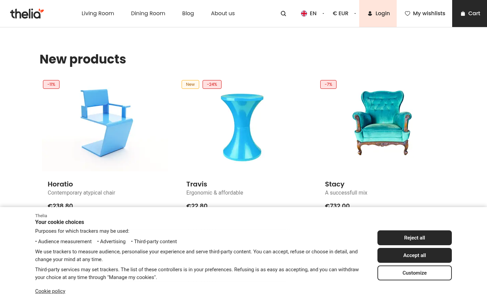
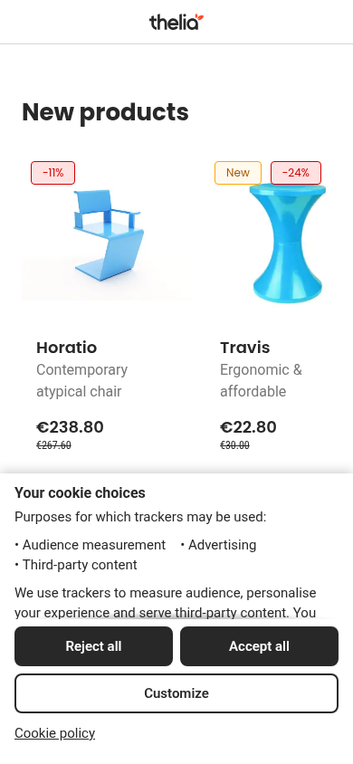
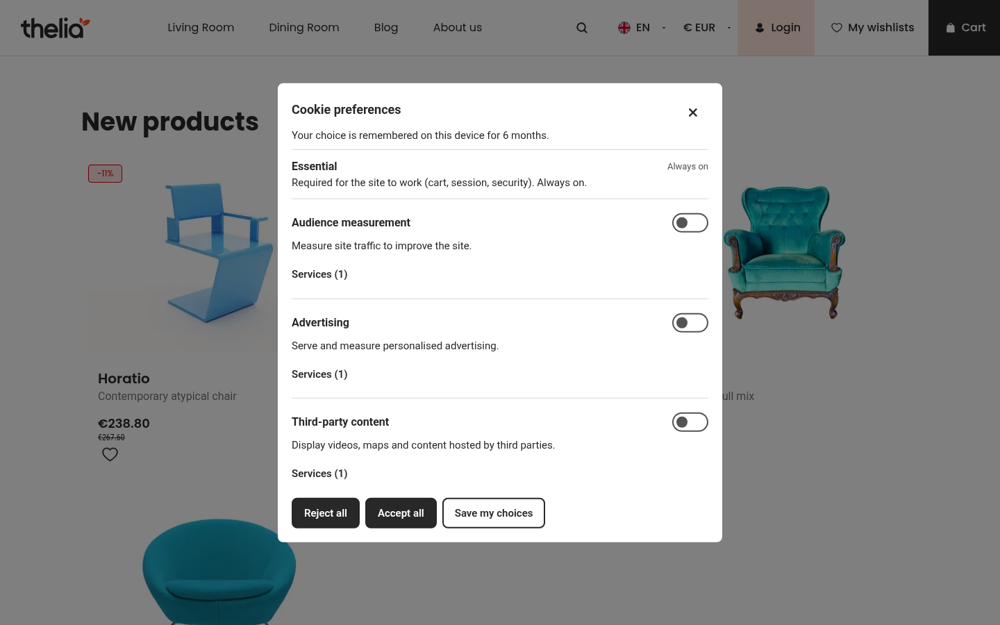
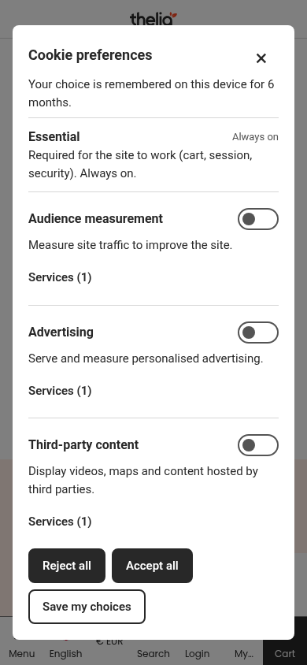
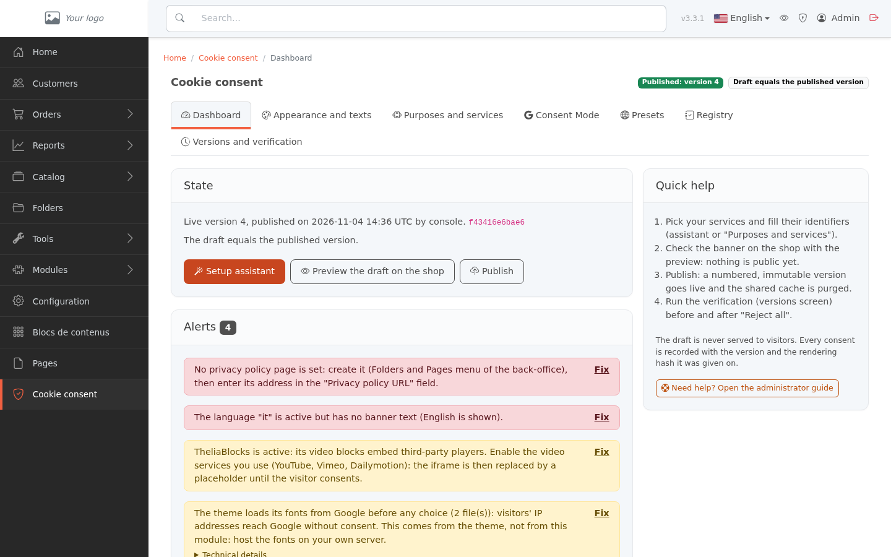

# CookieConsentManager

[English](README.md) | Français

Ce module vous aide à recueillir et à prouver le consentement. Il ne rend pas un site conforme à lui seul et ne constitue pas un conseil juridique.

CookieConsentManager est un module de consentement aux cookies et aux traceurs pour Thelia 3 (paquet `thelia/cookie-consent-manager-module`, code de module `CookieConsentManager`).

- Il affiche un bandeau à deux niveaux (barre ou fenêtre modale) où refuser demande un clic, un panneau de préférences et une page de préférences sans JavaScript à l'adresse `/ccm/preferences`.
- Il tient un registre des consentements avec une fiche de preuve imprimable, un export CSV et une purge selon la durée de conservation. Les versions publiées sont immuables, et rien n'est servi tant qu'un administrateur n'a pas publié.
- Il bloque les scripts et contenus intégrés tiers jusqu'au consentement, avec un catalogue de services dérivé de tarteaucitron.js (23 services vérifiés, 213 expérimentaux) et un moyen pour d'autres modules de déclarer les leurs.
- Il envoie les signaux Google Consent Mode v2 (basique ou avancé, `gtag` et Google Tag Manager).
- Le bandeau, le panneau et le back-office sont traduits en français, anglais, allemand, néerlandais, espagnol et italien. Un préréglage France (CNIL) fournit textes et réglages.

Ce n'est pas une CMP certifiée IAB TCF ni par Google. Licence MIT.

## Captures d'écran

 

Le bandeau (disposition en barre) sur ordinateur et sur téléphone. « Tout refuser » est aussi visible que « Tout accepter ».

 

Le panneau de préférences : un interrupteur par finalité, avec les services de chaque finalité listés dessous. Ici, Google Analytics, Meta Pixel et YouTube sont activés. Les captures sont en anglais, langue de cette boutique.



Le tableau de bord du back-office : version publiée, assistant de démarrage, aperçu, publication et alertes sur la configuration.

## Compatibilité

PHP 8.3 ou plus récent. `composer.json` exige `thelia/core ^3.0`. Le thème Flexy (hooks `layout.*`) est pris en charge, et tout autre thème fonctionne grâce à un repli neutre.

| | 3.0 | 3.1 | 3.2 | 3.3 |
|---|-----|-----|-----|-----|
| Niveau de test | smoke | smoke | smoke | complet |
| Injection dans `layout.head.top` et `layout.body.top` (Flexy) | oui | oui | oui | oui |
| Lien « Gérer mes cookies » | hook `layout.footer.top` | hook `layout.footer.top` | slot `footer_links` | slot `footer_links` |
| Purge du cache partagé à la publication | sans objet | sans objet | sans objet | oui |
| Purge planifiée du registre | cron et commande | cron et commande | cron et commande | worker `scheduler_thelia` ou cron |

« Smoke » désigne l'installation, l'activation, l'injection, le bandeau et un choix enregistré, vérifiés sur Thelia 3.0.0, 3.1.6 et 3.2.5 le 2026-10-31. Les limites propres à chaque version sont indiquées dans la documentation.

## Installation

À la racine du site Thelia (avec DDEV, préfixez les commandes par `ddev`) :

```bash
composer require thelia/cookie-consent-manager-module
php Thelia module:refresh
php Thelia module:activate CookieConsentManager
php Thelia cache:clear
```

- Composer place le module dans le dossier défini par les `installer-paths` du squelette Thelia (type `thelia-module`). Tant que le paquet n'est pas publié sur Packagist, déclarez le dépôt Git ou un dépôt `path` dans `composer.json`.
- `module:refresh` exécute `install()` : il crée les cinq tables `ccm_*` avec `CREATE TABLE IF NOT EXISTS` et ne supprime jamais rien.
- Sur une console standard, `module:activate` peut rester silencieux (observé sur 3.0). Vérifiez avec `php Thelia list ccm`, qui affiche `ccm:config:export`, `ccm:config:import`, `ccm:config:publish`, `ccm:registry:purge`, `ccm:services:sync` et `ccm:stats:rebuild`. Le back-office affiche « Consentement aux cookies » dans le menu du haut. Vous pouvez aussi activer le module dans Configuration, Modules.
- Après l'activation, un brouillon vide existe. Rien n'est injecté tant qu'une version n'est pas publiée, hormis l'aperçu du brouillon.

Premiers pas : back-office, « Consentement aux cookies », assistant de démarrage, aperçu, puis publication. Voir le [guide administrateur](docs/fr/guide-administrateur.md).

## Brancher le module sur un thème

Avec le thème Flexy, le bandeau est injecté par les hooks `layout.head.top` et `layout.body.top`. Avec un autre thème, appelez `theme_hook('layout.head.top')` et `theme_hook('layout.body.top')` dans son `base.html.twig`. Les gabarits se surchargent un par un ; voir le [guide intégrateur](docs/fr/guide-integrateur.md).

Quand le module est désactivé, les fonctions Twig `ccm_has_consent`, `ccm_has_purpose_consent`, `ccm_placeholder` et `ccm_open_link` n'existent plus, et un gabarit qui les appelle fait échouer tout le site. Entourez ces appels de la garde décrite dans le [guide intégrateur](docs/fr/guide-integrateur.md).

## Remplacer un Google Tag Manager codé en dur

1. Désactivez le module Thelia `GoogleTagManager` s'il est actif (le service de ce module refuse de s'activer à côté).
2. Retirez du thème le snippet `<script>` de GTM et son `<noscript><iframe>`. Le `noscript` charge GTM sans consentement.
3. Dans le back-office, « Finalités et services », activez « Google Tag Manager » et saisissez l'identifiant du conteneur.
4. Laissez le Consent Mode sur « Basique », et utilisez les déclencheurs `ccm_consent_ready` et `ccm_consent_update` dans GTM.
5. Publiez, puis lancez la Vérification avant et après « Tout refuser ».

La procédure complète est dans le [guide intégrateur](docs/fr/guide-integrateur.md).

## Mise à jour

```bash
composer update thelia/cookie-consent-manager-module
php Thelia module:refresh
php Thelia cache:clear
```

- `module:refresh` exécute `update()` : le schéma est réappliqué (idempotent), puis les éventuels scripts de mise à jour livrés dans `Config/update/`, et les services déclarés par d'autres modules sont synchronisés.
- Le catalogue de services fourni suit la version du module (tarteaucitron.js v1.37.0 aujourd'hui). Il n'y a pas de mise à jour du catalogue seule.
- Une publication est nécessaire après la plupart des mises à jour. Les visiteurs reçoivent un script versionné `/ccm/<version>-<hash>.js`, et le hash couvre le moteur, la couche de compatibilité, les fragments et les gabarits.
  Quand le hash servi diffère de celui de la version publiée, le tableau de bord affiche une alerte rouge « The served rendering (...) differs from version ... ». Publiez de nouveau depuis le back-office, ou depuis la console :

  ```bash
  php Thelia ccm:config:publish --comment="Module update"
  ```

  La commande refuse de publier (code de sortie 1) quand rien n'a changé depuis la dernière version ; après une mise à jour, le hash servi a changé, donc elle passe. Ajoutez `--force` pour publier malgré tout. `--substantial` réaffiche le bandeau à tout le monde, ce dont une mise à jour du module n'a pas besoin.
- `php Thelia ccm:stats:rebuild` recalcule depuis le registre les statistiques du premier choix, sans jamais modifier le registre. Lancez-la si les chiffres du tableau de bord semblent faux ou vides, par exemple après une restauration du registre, et après une mise à jour pour recompter les jours encore couverts.
- Les versions publiées sont immuables : une mise à jour du module ne change jamais ce à quoi un visiteur a consenti.

## Déployer une configuration depuis la console

```bash
php Thelia ccm:config:export --output=ccm-config.json       # exporte le BROUILLON, pas la version publiée
php Thelia ccm:config:import ccm-config.json                 # crée un brouillon, ne publie jamais
php Thelia ccm:config:publish --confirm-environment --comment="Go live"
```

- Les champs d'environnement (identifiants de services, adresse de la politique, régions) viennent d'un autre site. L'import les liste, et vous devez les confirmer ou les ressaisir avant de publier. Sans `--confirm-environment`, la publication est refusée.
- `ccm:config:import` se termine avec le code `0` quand le brouillon est créé. Les champs à confirmer sont affichés comme avertissements, ce qui n'est pas un échec. Tout autre code signifie que le fichier était illisible ou refusé. Seules les adresses invalides et les codes de finalité invalides bloquent l'écriture ; les autres erreurs sont importées pour que vous les corrigiez dans le back-office.
- Options de `ccm:config:publish` : `--confirm-environment`, `--substantial`, `--force`, `--comment=<texte>`.
- Le schéma du fichier est `Config/schema/ccm-config-1.schema.json`. La clé `registry.link_customer` des anciens exports est ignorée à l'import.
- Purge du registre : `php Thelia ccm:registry:purge` (`--dry-run` ne fait que compter). Planifiez-la, par exemple `17 3 * * *`. Sur Thelia 3.3 avec un worker sur `scheduler_thelia`, une tâche quotidienne à 03:17 existe déjà.

## Désactivation et suppression

- `php Thelia module:deactivate CookieConsentManager` arrête toute injection (ni bandeau, ni script, ni Consent Mode). Les données sont conservées et le registre est intact après la réactivation.
- Supprimer le module depuis le back-office avec l'option de suppression des données du module efface les cinq tables `ccm_consent_entry`, `ccm_daily_stat`, `ccm_draft_setting`, `ccm_service_config` et `ccm_version`, ainsi que le réglage `ccm_last_purge_at`. `composer remove` seul laisse les tables en place.

## Limites

- Ce n'est pas une CMP certifiée IAB TCF 2.2 ni par Google. Non couverts : géolocalisation côté serveur, consentement inter-domaines, nonce CSP, signal de consentement de Microsoft Clarity.
- Le module ne peut pas authentifier un visiteur anonyme : le registre prouve ce que le navigateur a envoyé, pas qui l'a envoyé.
- Le droit de publier (CREATE sur le module dans Configuration, profils Administrateur) permet à un utilisateur de servir du JavaScript à tous les visiteurs, via les services personnalisés. Le même droit est exigé pour écrire ou changer le code ou l'adresse de script d'un service, saisir ou changer un paramètre du catalogue qui est une adresse chargée comme script (l'adresse de Matomo, le domaine personnalisé d'une balise Google), importer une configuration, restaurer une version et activer les services expérimentaux. Accordez-le avec soin.
- Derrière un reverse proxy ou un CDN, déclarez le proxy dans `framework.trusted_proxies`. Le point d'entrée du registre est limité à 120 requêtes par minute et par adresse client ; sans cette déclaration, tous les visiteurs partagent un seul compteur.
- Le thème Flexy charge les polices Google avant le hook `layout.head.top`. Le module ne peut pas l'empêcher ; hébergez les polices sur le site. Le tableau de bord et la Vérification le signalent.
- Le cache partagé de Thelia 3.3 ne sert que les visiteurs sans cookie : une page qui appelle `ccm_has_consent` doit rester en dehors.
- Sur une boutique servie par plusieurs serveurs ayant chacun un cache applicatif local, une publication peut mettre jusqu'à 300 secondes à les atteindre tous.
- Les durées de cookies sans source officielle (Meta Pixel, par exemple) ne sont pas fournies ; l'administrateur les saisit. Les 213 services importés sont expérimentaux.
- Les cookies tiers posés sur un domaine tiers ne peuvent pas être effacés par le module. La Vérification ne voit pas les cookies `HttpOnly` ni les requêtes à l'intérieur des iframes tierces.
- Le script en ligne de l'en-tête de page ne porte pas de nonce CSP ; la feuille de style est un fichier de votre propre origine. Le moteur n'a pas besoin de `unsafe-eval`.
- Aucun des quatre outils de mesure d'audience pouvant être exemptés de consentement n'a été testé sur un compte réel.

## Documentation

- [Guide administrateur](docs/fr/guide-administrateur.md) : marchands et chefs de projet (version anglaise : [administrator guide](docs/administrator-guide.md)).
- [Guide intégrateur](docs/fr/guide-integrateur.md) : thème, surcharge de gabarits, API JavaScript et Twig, autres modules, CSP, tests (version anglaise : [integrator guide](docs/integrator-guide.md)).
- [Fonctionnement à l'exécution](docs/runtime-contracts.md) (en anglais) : cookie de consentement, point d'entrée du registre, configuration publiée, script servi.
- [Maintenir le catalogue de services](docs/maintaining-the-catalogue.md) (en anglais) : mise à jour depuis une nouvelle version de tarteaucitron.js.
- [Décisions](docs/decisions/) (en anglais) : pourquoi le catalogue de services, la garde du Consent Mode, les préréglages, la liste d'exemptions, le consentement périmé et la conservation des preuves fonctionnent ainsi.
- [CHANGELOG](CHANGELOG.md) (en anglais).
- `Resources/catalogue/REPORT.md` (en anglais) : origine et contenu du catalogue de services.

## Licence

MIT (`composer.json`). Le catalogue de services et les fragments de `Resources/catalogue/` dérivent de tarteaucitron.js v1.37.0, Copyright (c) 2014 AmauriC, licence MIT. La mention est conservée dans `Resources/vendor/tarteaucitron/LICENSE` et dans l'en-tête du fichier embarqué.
